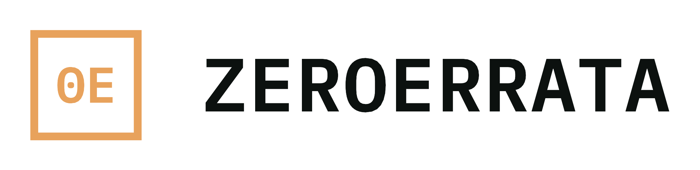
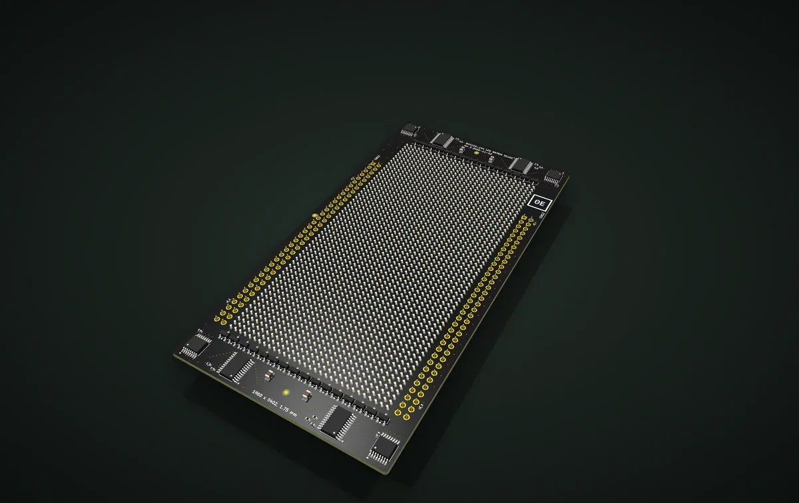
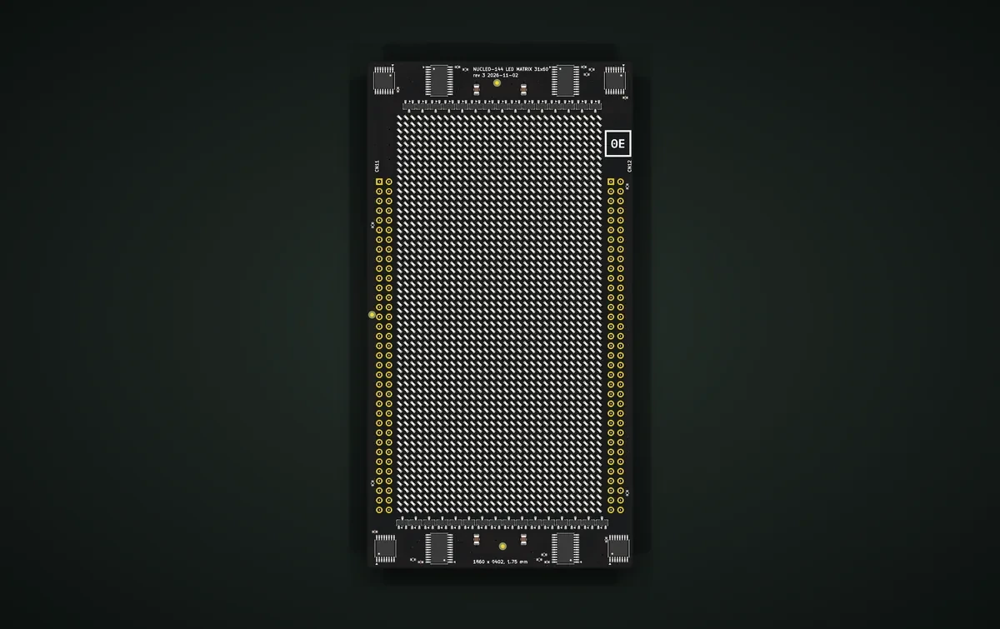
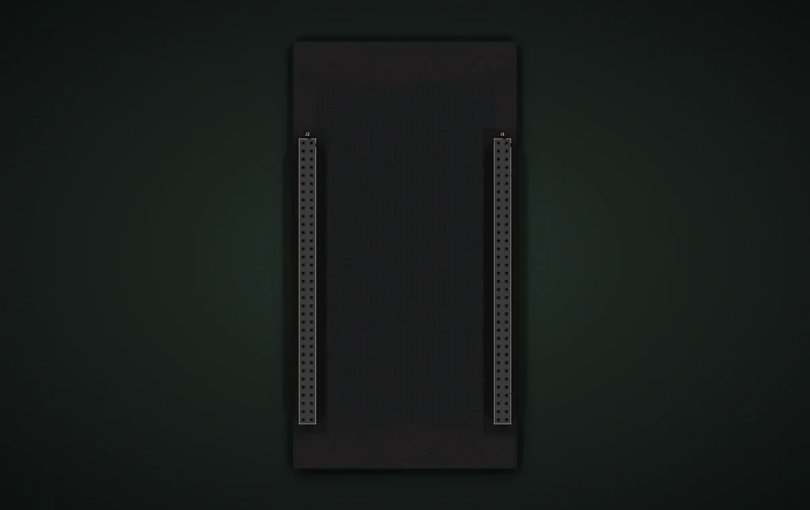
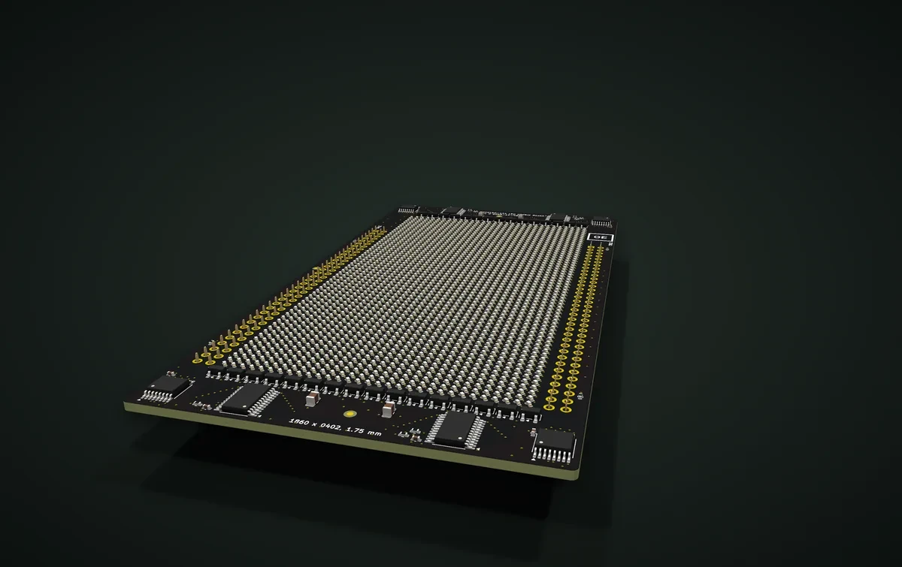

  <a href="https://zeroerrata.eu"><picture>
    <source media="(prefers-color-scheme: dark)" srcset="images/zeroerrata-logo-dark.png">
    
  </picture></a>

<h1 align="center">Nucleo-144 LED matrix shield: 1860 LEDs</h1>

<b>A full-size Nucleo-144 shield with a 31 x 60 matrix of red 0402 LEDs at 45 degrees, driven by constant-current sinks.</b>

  
  
  
  

## About

A display shield for STM32 Nucleo-144 boards (ST morpho connectors CN11 / CN12): 31 columns by 60 rows = 1860 red 0402 LEDs on a 1.75 mm square pitch, every LED turned 45 degrees, filling the whole Nucleo-144 outline. Columns are switched to +5 V by P-MOSFETs selected through four 3-to-8 decoders, rows are sunk by four 16-channel constant-current LED drivers at 5.7 mA per LED, and one column is lit at a time (1/31 duty), refreshed by the Nucleo's MCU.

A dense 4-layer board: rows on the top layer, a solid ground plane, column lanes and the switched column supplies on the inner and bottom layers.

## Features

- 1860 red 0402 LEDs (31 x 60) on a 1.75 mm pitch, rotated 45 degrees for a diamond pattern
- 4 x STP16CP05 constant-current row sinks (5.7 mA per LED, one resistor sets the current)
- 31 x AO3401A P-MOSFET column switches, selected by 4 x 74AHCT138 decoders
- Up to 341 mA in one column from the Nucleo +5 V; driver logic on +3.3 V
- Fits the Nucleo-144 outline and plugs into the ST morpho headers (NUCLEO-F429ZI / F767ZI family)
- One-sided JLCPCB assembly; the morpho sockets are hand-soldered

## Specifications

| | |
|---|---|
| Board | 70.0 x 133.4 mm, 4 copper layers, 1.6 mm |
| Finish | ENIG |
| Parts | 1927 |
| Release | rev 4, 2026-11-27 |
| LED matrix | 31 x 60 = 1860, red, 0402, 1.75 mm pitch |
| Host | STM32 Nucleo-144 (ST morpho CN11 / CN12) |
| Supply | +5 V and +3.3 V from the Nucleo |
| Stackup | 4 layers, 1.6 mm |

## Design values

- 5.7 mA per LED set by the drivers' current resistors; one column of up to 60 LEDs lit at a time: up to 341 mA from the Nucleo +5 V.
- 1/31 duty multiplex, refreshed by the Nucleo MCU.

## Renders

| Top | Bottom | Low |
|---|---|---|
|  |  |  |

## Files

| Folder | Contents |
|---|---|
| [`kicad/`](kicad) | KiCad 10 project: schematic, board, design rules, project libraries |
| [`docs/`](docs) | [schematic.pdf](docs/schematic.pdf), [board_layers.pdf](docs/board_layers.pdf) |
| [`fabrication/`](fabrication) | Gerber and drill files (zip), bill of materials, pick-and-place |
| [`images/`](images) | renders and copper layer pictures |
| [`analysis/`](analysis) | simulation and analysis results: bringup, dfm, retpath |

## Verification

- MCU pin map checked against the NUCLEO-F429ZI connector tables
- Every result is a prediction from design data; the board has not been measured unless stated.

## How to order

1. Upload `fabrication/gerbers_drill.zip` to your PCB fab; the stackup and finish are in the specifications above.
2. For assembly, use `fabrication/bom_jlcpcb.csv` and `fabrication/cpl_jlcpcb.csv` (JLCPCB format) or the KiCad-format `bom.csv` / `pos.csv`.
3. Check part stock and the footprints against the current data sheets before you order.

## Known issues

Found by the design review of this release; boards built from these files carry them:

- Crosstalk: the bottom drivers' clock couples a 0.73 V spike into their output-enable line (simulated). It stays below the logic threshold, so at worst a nanosecond dimming glitch; firmware avoids it by shifting column data while the outputs are off. Rev 4 re-routes these lines; the crosstalk check passes.
- Reflow balance: from rev 4 the small ground pads connect through thermal reliefs; use a profile with a 60-90 s soak at 150-180 C and inspect the 0402 resistors.
- Parts: rev 4 orders Samtec SSQ-135-01-T-D morpho sockets (second source Sullins PPPC352LFBN-RC) and current 22 uF capacitors; the STP16CP05TTR row drivers had little stock in 2026: buy the drivers before ordering boards.

## Notes

- The renders show the ZeroErrata house look; from rev 4 the fabrication package specifies it too: matte black solder mask, white silkscreen, ENIG.
- The firmware (column scan) is not part of this repository.

## Licence

Released under the [CERN Open Hardware Licence Version 2 - Permissive](LICENSE) (CERN-OHL-P-2.0): use, modify, make and sell it, also commercially. Provided as is, without warranty.

---

  Designed by <a href="https://zeroerrata.eu"><b>ZeroErrata</b></a>: PCB design, verified before it is ordered. 
  <a href="https://zeroerrata.eu">zeroerrata.eu</a> · <a href="mailto:hello@zeroerrata.eu">hello@zeroerrata.eu</a>

